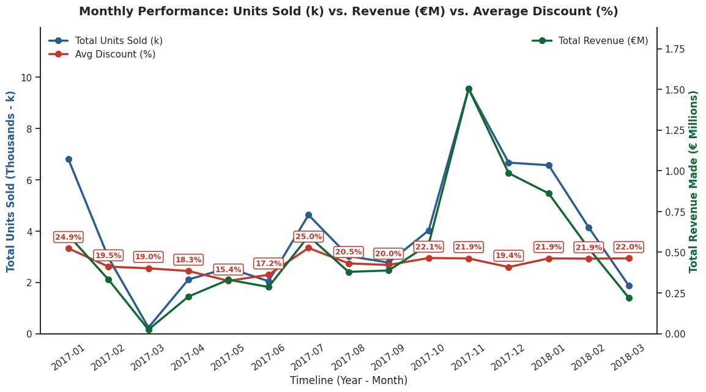
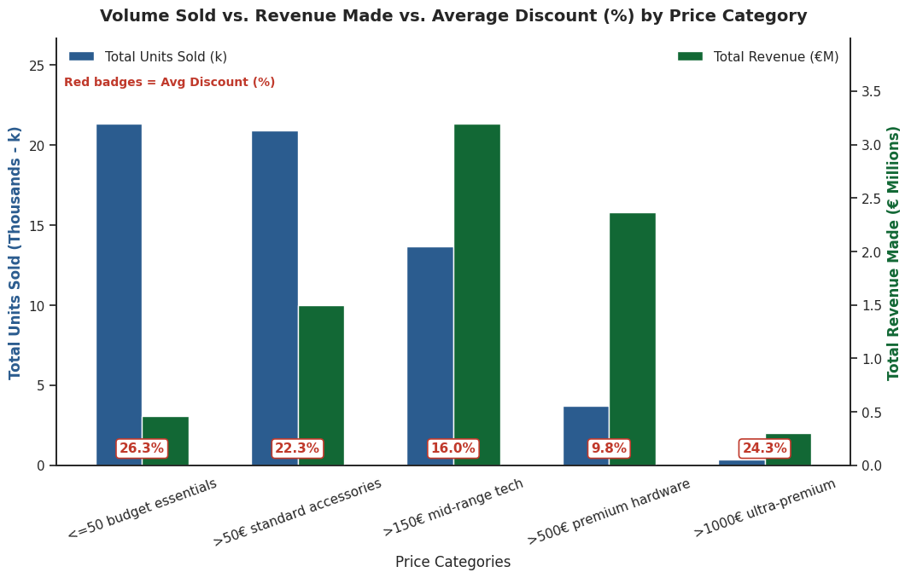
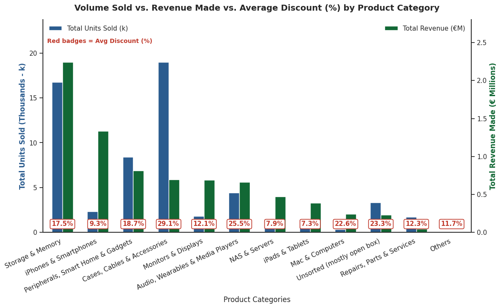
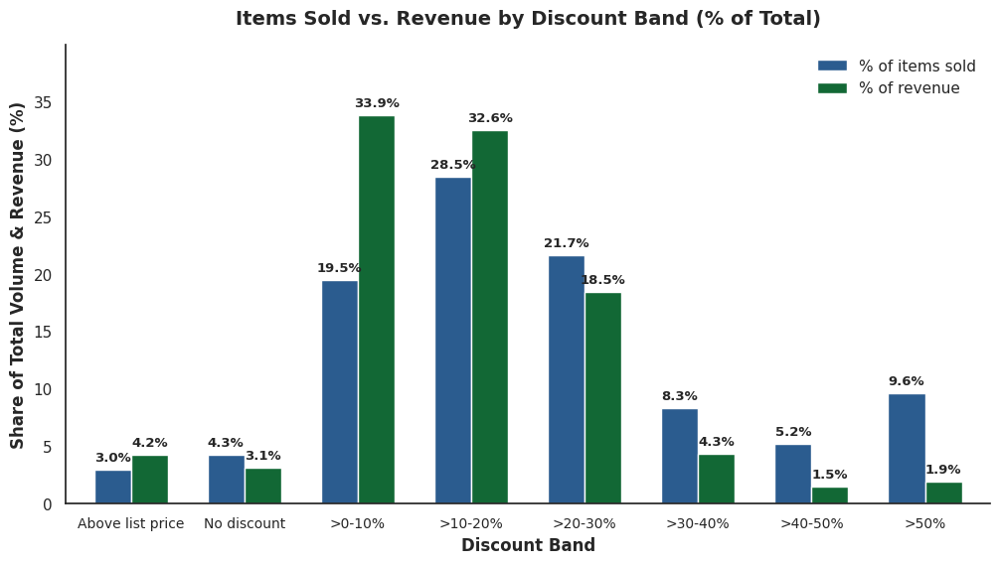

# Is Discounting Good for Eniac? A Python Data Cleaning & Analysis Project

## 🎯 Project Overview

This was a group case study I completed as part of the **[WBS Coding School](https://github.com/WBSCodingSchool) Data Analytics Bootcamp**.

**The scenario:** Eniac, an online store selling Apple products and Apple-compatible accessories, was split on its discount strategy:

- **The Marketing Team Lead** believed discounts win new customers, keep them loyal and help the company grow.
- **The board** was worried: last quarter, orders went up but revenue went down. They want Eniac to be a quality brand, not the cheapest shop.

**The point of the case study:** clean Eniac's messy sales database in Python and use it to answer the question: *is discounting good for the business?*

**Our answer: discount less, and more carefully.** Almost every sale is discounted, all year round. But sales follow the calendar (Black Friday, Christmas), not the size of the discount, and most revenue comes from sales with small discounts.

**Team:** Catalina Mayer, Ali Haydar Dogan, Louise Gorman.

**Result:** [Final Presentation (PDF)](documentation/slides/eniac-board-presentation.pdf)

## 📊 Dataset & Sources

- **Source:** Eniac's internal database, provided by [WBS Coding School](https://github.com/WBSCodingSchool): 4 tables (orders, order lines, products, brands)
- **Time period:** 1 January 2017 to 14 March 2018
- **After cleaning:** 40,985 completed orders, 53,231 order lines, 9,992 products

**Key decisions and limits:**

- The raw data was messy: 8,746 duplicate products, missing values, dates stored as text, and **36,169 prices that couldn't be read** (e.g. `1.137.99`). Every cleaning step and how many rows it removed is documented in the notebooks.
- Only **completed** orders were used. Most of the 226,909 raw orders were unfinished shopping baskets.
- **Every sale of €1,000 or more is missing.** Those were the unreadable prices, so the whole orders were removed. Expensive products (especially Macs) are under-represented.
- There is **no cost data**, so we measure **revenue** (money coming in), not profit.
- **March 2017 is mostly missing** (only 241 items sold), and March 2018 stops on the 14th.
- **Discount** = (list price − price paid) ÷ list price, averaged over order lines.

## 🚀 Key Findings

- **Discounting is the norm, not a special event.** **93%** of items were sold below list price, and **96%** of products were discounted at least once.
- **Discounts are big.** The average discount is **21%** per order line. In total, discounts took **€1.53M** off a list value of €9.34M.
- **Sales follow the calendar, not the discount.** Sales peak in **November** (Black Friday month: **€1.50M**, 19% of all revenue) and stay high until Christmas. The average discount stays between **15% and 25%** in every month.
- **The board's "revenue went down" is seasonal.** Revenue falls after Christmas every year. January and February 2018 were both **higher** than the same months in 2017.
- **Cheap items get the biggest discounts but bring in little revenue.** Items under €50 are discounted **26%** and bring in **6%** of revenue. Items from €150 to €1,000 bring in **71%** of revenue, with discounts of only **10–16%**.
- **The best earners aren't the most discounted.** Cases, cables & accessories: 29% discount, €0.70M. iPhones: 9% discount, €1.33M.
- **Small discounts bring in the most money.** Discounts of up to 20% bring in **two thirds of revenue**.

**Recommendation:** keep discounts small and targeted.

1. **Stop blanket discounting** all year round.
2. **Lower discounts on items over €150 to about 10%.** They bring in over 70% of revenue, so every 1% of discount costs the most euros here.
3. **Save big discounts for key dates:** Black Friday, Christmas and clearing old stock.
4. **Test before changing everything:** lower the discount on a small group of products first and measure what happens to sales.

## 📈 Visualisations

### Sales follow the calendar. The average discount stays near 20% all year



*Blue = items sold, green = revenue, red = average discount per month. Sales and revenue jump in November (Black Friday) and fall after Christmas, while the discount stays between 15% and 25%.*

### Cheap items get the biggest discounts but bring in little revenue



*Items under €50 sell the most and get a 26% discount, but bring in only 6% of revenue. Items from €150 to €1,000 bring in 71% of revenue. The "over €1,000" group is incomplete because those sales are missing from the data.*

### Accessories get the biggest discounts. Phones and tablets get the smallest



*Cases, cables & accessories sell the most items at a 29% discount but bring in €0.70M. iPhones sell few items at a 9% discount and bring in €1.33M. Mac & Computers looks small only because sales of €1,000 or more are missing.*

### About two thirds of revenue comes from discounts of up to 20%



*Blue = share of items sold, green = share of revenue. Deeper discounts sell items but bring in little revenue.*

## 🛠️ Technologies Used

- **Python:** pandas (cleaning and analysis), seaborn (charts)
- **Notebooks:** Google Colab
- **Presentation:** Google Slides

## 📁 Project Structure

```
├── README.md
├── data/
│   ├── raw-data/                       # Original tables from Eniac
│   └── clean-data/
│       ├── *_cl.csv                    # Cleaned tables (from notebook 01)
│       ├── *_qu.csv                    # Quality-checked orders and order lines (from notebook 02)
│       └── products_categorised.csv    # Products with categories (from notebook 03)
├── scripts/
│   ├── 01_data-cleaning.ipynb          # Duplicates, missing values, data types, broken prices
│   ├── 02_data-quality.ipynb           # Completed orders only, unknown products, totals that don't add up
│   ├── 03_product-categories.ipynb     # 9,992 products sorted into 12 categories
│   └── 04_analysis-charts.ipynb        # Answers the business questions, draws the slide charts
├── documentation/
│   └── slides/
│       └── eniac-board-presentation.pdf   # Final slides
└── images/
    └── *.png                           # Charts shown in this README
```

## 🔗 How to Use This Project

1. **Quick look:** read the [final presentation (PDF)](documentation/slides/eniac-board-presentation.pdf). It's the 5-minute summary.
2. **Check the numbers:** open the notebooks in [`scripts/`](scripts/) in order (01 → 04). Every step shows its result, followed by a short "What we see" note.
3. **Run them yourself:** open a notebook in Google Colab and run all cells. Each one loads its input files from shared Google Drive links, so no setup is needed.

## 📬 Contact

- **LinkedIn:** [https://linkedin.com/in/louise-gorman](https://linkedin.com/in/louise-gorman)
- **GitHub:** [https://github.com/louisegorman](https://github.com/louisegorman)
